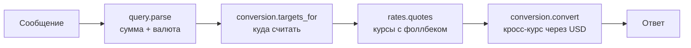

# 💱 NekoCurrencies

[](https://github.com/aneek0/NekoCurrencies/actions/workflows/ci.yml)


Telegram-бот, который сам находит сумму и валюту в тексте сообщения и пересчитывает её в ваши валюты. Без команд и меню: написали `100 долларов` — получили ответ в евро, рублях и биткоине.

## Как это выглядит

```
Вы:  100 долларов

Бот: 🇺🇸100.00$ USD

     🇪🇺92.00€ EUR
     🇷🇺9,250.00₽ RUB
     🇧🇾327.00Br BYN

     0.00149254 BTC
```

Курсы в примере условные — подставлены заглушкой вместо живого источника.

## Что понимает

| Сообщение | Что распознаёт | Нужный режим |
|---|---|---|
| `100 долларов`, `50€`, `$50`, `1000 рублей` | сумма + валюта | любой |
| `1.5к баксов`, `1.5кк`, `1,5к usd` | сокращения `к`/`кк` | любой |
| `0.5 биткоин`, `10 битков` | крипта | любой |
| `EUR 20`, `20 usd` | код валюты перед суммой | стандартный |
| `(20 + 5) * 4 доллара` | арифметика | стандартный |
| `двадцать пять евро` | числа словами (W2N/M2N) | расширенный |

126 фиатных валют и 27 криптовалют, включая алиасы вроде `бакс`, `р.`, `тенге`, `тг`, `биток`.

## Режимы обработки

| Режим | Что делает | Кому |
|---|---|---|
| `simplified` | только «число + валюта», без выражений и слов | тем, кто хочет предсказуемости |
| `standard` *(по умолчанию)* | + арифметика, + код валюты перед суммой | большинству |
| `advanced` | + числа словами и разрядность | максимальное понимание |

Переключение — `/settings` → «Режим обработки».

## Быстрый старт

```bash
git clone https://github.com/aneek0/NekoCurrencies.git
cd NekoCurrencies
cp .env.example .env      # вписать BOT_TOKEN, остальное по желанию
uv sync
uv run python bot.py
```

## Команды

| Команда | Алиас | Назначение |
|---|---|---|
| `/start` | `/старт` | главное меню |
| `/help` | `/помощь` | справка |
| `/settings` | `/настройки` | режим, валюты, источник курсов, отладка, язык, оформление |
| `/version` | `/версия` | версия |

В `/settings` → «Оформление» три переключателя: флаги, коды валют, символы. Комбинации дают
`🇺🇸1,234.50$ USD` → `1,234.50$ USD` → `1,234.50 USD` → `1,234.50`.

## Инлайн-режим

`@ваш_бот 20 баксов` — ответ прямо в любом чате, без добавления бота в него. Если валюты не выбраны в настройках, берётся набор по умолчанию: USD, EUR, RUB, BYN, BTC.

## Источники курсов

Приоритет при `api_source=auto`:

1. **Frankfurter** — фиат, 84 центральных банка (без ключа)
2. **НБРБ** — официальные курсы BYN (без ключа)
3. **CurrencyFreaks** — фиат и крипта (нужен ключ)
4. **ExchangeRate-API** — резервный фиат (нужен ключ)
5. **CoinGecko** — крипта к USD (без ключа, включается сам)

Фиатный источник не блокирует крипту: провайдер подбирается под запрошенные валюты. В `/settings` → «Источник курсов» можно поставить любой из 1–4 первым — остальные останутся фоллбеком. Курсы кэшируются на `CACHE_LIFETIME` секунд, упавший источник пропускается на минуту, ответ на пользователя — не чаще раза в `RATE_LIMIT_PERIOD` секунд (админы из `ADMIN_IDS` не ограничены).

## Переменные окружения

| Переменная | Обязательная | Описание |
|---|---|---|
| `BOT_TOKEN` | ✅ | Токен Telegram-бота (@BotFather) |
| `CURRENCY_FREAKS_API_KEY` | ❌ | API-ключ CurrencyFreaks (фоллбек для крипты) |
| `EXCHANGE_RATE_API_KEY` | ❌ | API-ключ ExchangeRate-API (резерв) |
| `ADMIN_IDS` | ❌ | ID администраторов через запятую (без rate limit) |
| `RATE_LIMIT_PERIOD` | ❌ | Минимальный интервал запросов, сек (1.0) |
| `CACHE_LIFETIME` | ❌ | Время жизни кэша курсов, сек (600) |
| `LOG_LEVEL`, `LOG_FILE` | ❌ | Уровень и файл логов (INFO, `logs/bot.log`) |
| `DATABASE_FILE` | ❌ | Путь к SQLite (`data/users.db`) |
| `BOT_VERSION` | ❌ | Версия, которую показывает `/version` (1.1.0) |

## Как устроено



Каждый слой знает только соседа: разбор не знает про сеть, источники курсов не знают про Telegram, отрисовка не знает, откуда взялись цифры. Поэтому новый провайдер — это адаптер в `rates.py` плюс одна строка в `settings.py`, а новая валюта — строка в `catalog.py`.

## Структура проекта

```
bot.py          — Telegram: хендлеры, middleware, запуск
query.py        — разбор сообщения в Query(сумма, валюта)
conversion.py   — политика конвертации и отрисовка ответа
rates.py        — источники курсов, порядок опроса, кэш, кулдаун
catalog.py      — каталог валют: коды, категории, подписи, алиасы, символы
settings.py     — реестр настроек: режимы, источники API, оформление, языки
math_parser.py  — вычисление арифметических выражений
database.py     — SQLite-хранилище настроек (Preferences)
keyboards.py    — inline-клавиатуры (строятся из settings/catalog)
localization.py — тексты (ru/en)
config.py       — переменные окружения и URL провайдеров
tests/          — тесты (pytest)
```

## Тесты

```bash
uv run pytest tests/ -v
```

Локальный эквивалент CI:

```bash
uv run --with pyflakes python -m pyflakes \
  bot.py catalog.py config.py conversion.py database.py \
  keyboards.py localization.py math_parser.py query.py rates.py settings.py
```

## Технологии

- **Python 3.11+**
- **aiogram 3.x** — Telegram Bot API
- **httpx** — HTTP-клиент
- **sqlite3** — база данных (WAL mode)
- **uv** — менеджер зависимостей

## Лицензия

MIT